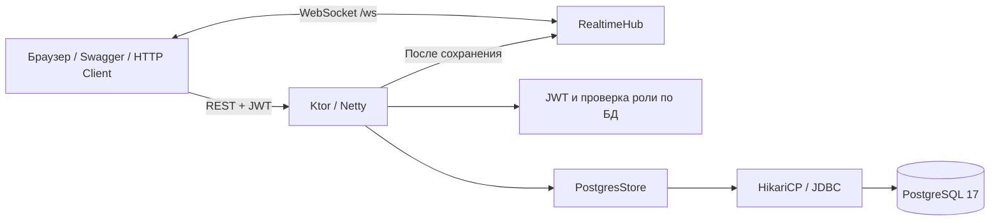

# Архитектура и база данных

Приложение — один Ktor/Netty-процесс с REST API, WebSocket и локальными статическими ресурсами браузерного клиента. PostgreSQL хранит пользователей, сообщения и оповещения. JDBC-вызовы выполняются в `Dispatchers.IO` через HikariCP, чтобы не блокировать обработку запросов. Для каждого запроса используются подготовленные SQL-выражения с параметрами.

## Файлы

| Файл / каталог | Назначение |
| --- | --- |
| `Main.kt` | Чтение настроек, схема БД, начальный администратор, запуск Netty |
| `Settings.kt` | Переменные окружения и проверка обязательных настроек |
| `Application.kt` | Плагины Ktor, маршруты, проверка JSON, ролей и ошибок |
| `Security.kt` | Хеши паролей, выпуск и проверка JWT, получение актуального пользователя |
| `Database.kt` | Пул соединений, транзакции, применение схемы |
| `PostgresStore.kt` | Подготовленные SQL-запросы и преобразование строк БД в модели |
| `Realtime.kt` | Авторизация первым кадром, соединения, чат и адресные оповещения |
| `Models.kt` | DTO JSON и интерфейс хранилища |
| `Documentation.kt` | OpenAPI и Swagger UI из локального WebJar |
| `resources/db/schema.sql` | Идемпотентное создание таблиц и индексов |
| `resources/static/` | Браузерный интерфейс, JavaScript и CSS |
| `src/test/` | Проверки API, безопасности, WebSocket и интеграция с PostgreSQL |

Все Kotlin-файлы находятся в `src/main/kotlin/ru/student/realtime`.

## Схема PostgreSQL

| Таблица | Поля и ограничения |
| --- | --- |
| `users` | `id BIGSERIAL PK`, `username VARCHAR(32) NOT NULL`, `password_hash TEXT NOT NULL`, `role VARCHAR(5) NOT NULL DEFAULT 'user'`, `created_at TIMESTAMPTZ` |
| `chat_messages` | `id BIGSERIAL PK`, `user_id BIGINT FK → users.id ON DELETE RESTRICT`, `text TEXT NOT NULL` длиной 1–2000, `created_at TIMESTAMPTZ` |
| `notifications` | `id BIGSERIAL PK`, `user_id BIGINT FK → users.id ON DELETE CASCADE`, `title VARCHAR(100)` длиной 1–100, `message TEXT` длиной 1–2000, `is_read BOOLEAN DEFAULT FALSE`, `created_at TIMESTAMPTZ` |

`users.username` хранится в нижнем регистре; уникальный индекс по `lower(username)` защищает от повторной регистрации и гонок. Проверка `role IN ('admin','user')` действует и на уровне БД. Индекс `(user_id, id DESC)` ускоряет получение личных оповещений; первичный ключ сообщений используется для курсора `before` и обратной сортировки. Во внешнем API поле `is_read` называется `read`.

Схема применяется при запуске через `CREATE ... IF NOT EXISTS` в транзакции. Это достаточно для первого развёртывания учебного проекта; изменения уже созданных таблиц требуют отдельных миграций. Оповещение всем пользователям создаётся одной транзакцией, по отдельной записи на получателя. После сохранения сервер публикует события подключённым клиентам; офлайн-получатель получает записи при следующем REST-запросе.

## Доступ и обмен событиями

Пароли хранятся в виде PBKDF2-HMAC-SHA256 с индивидуальной случайной 16-байтовой солью, 210 000 итераций и 256-битным результатом; исходный пароль не сохраняется. JWT подписывается HMAC-SHA256 и проверяется по подписи, issuer, audience и сроку действия. Для REST актуальная роль извлекается из PostgreSQL при каждом запросе. Изменение роли не требует нового JWT, хотя старое поле `role` внутри самого токена остаётся прежним до следующего входа.

WebSocket требует JWT в первом JSON-кадре и закрывается по истечении срока действия токена. `RealtimeHub` содержит соединения в памяти, рассылает чат всем участникам и фильтрует оповещения по `userId`. У каждого соединения ограниченная очередь из 64 событий; медленный клиент отключается, чтобы не задерживать остальных. История восстанавливается из PostgreSQL через REST.

JWT не имеет refresh-токенов и отдельного списка отзыва в этой версии: после истечения пользователь входит повторно. Рассылка рассчитана на один экземпляр приложения. Для масштабирования на несколько контейнеров понадобится общий брокер (например, PostgreSQL LISTEN/NOTIFY или Redis), а для развития схемы — версионируемые миграции.
